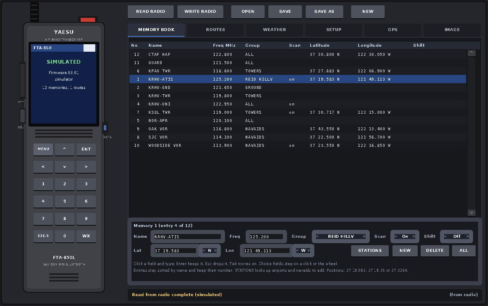
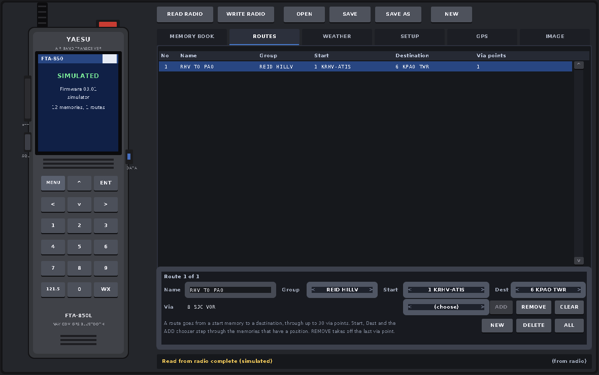
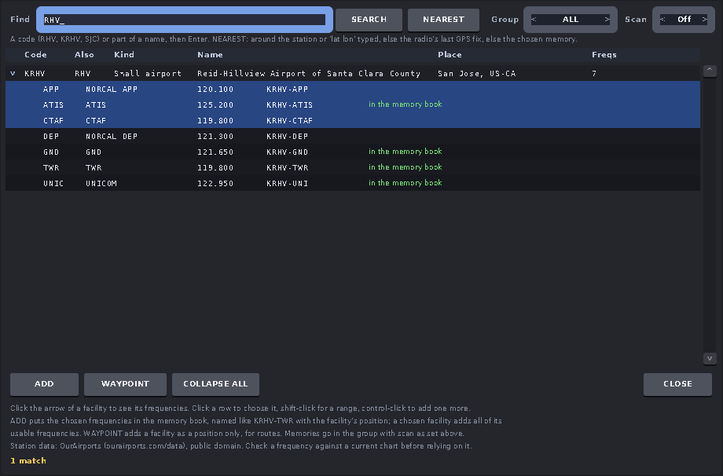

# FTA-850 programmer

The user manual is [doc/manual.md](doc/manual.md). This file is the
technical side: building, the protocol, the files.

A programmer for the Yaesu FTA-850L, FTA-750L, FTA-550L and FTA-450L air
band handhelds. The model is read from the radio when the session starts
(and from any file opened), and the pages follow it:

| Model | Image | Memories | Names | Routes | GPS | NAV band | Positions | CP mode key |
|---|---|---|---|---|---|---|---|---|
| FTA-850L | 32 kB | 400 | 14 | 40 | yes | yes | yes | SQL |
| FTA-750L | 16 kB | 200 | 15 | no | yes | yes | yes, with a runway course | MENU |
| FTA-550L | 16 kB | 200 | 15 | no | no | yes | yes | MENU |
| FTA-450L | 16 kB | 200 | 15 | no | no | no | no | MENU |

The FTA-850L has been exercised on a real radio. The other three were built
from Yaesu's YCE01 software and its default images and checked against the
simulator only, so on a real one: READ RADIO, SAVE the file, and write it
back unchanged before trusting any edit.

A program for Linux and macOS that programs a Yaesu FTA-850L air band
transceiver over its USB port: the memory book, the routes, the weather
channel names, the setup menus, and the GPS logger. It is written in C using
the AMI tool kit, and the window shows the radio on the left with its LCD
reporting the link, and the programmer's pages on the right. It does what
Yaesu's Windows-only YCE46 software does, reads and writes the same `.dat`
files, and talks the same protocol, which was read from that software.

## Build and run

    make                     # needs ~/projects/amitk built (or set AMIDIR)
    ./fta850                 # finds the radio on USB
    ./fta850 -p /dev/ttyACM0 # Linux, a given port
    ./fta850 -p /dev/cu.usbmodem1411      # macOS
    ./fta850 --sim           # no hardware: a simulated radio with some memories
    make sim                 # same as ./fta850 --sim
    make install             # FTA-850 and FTA-850 (simulated) in the Linux app menu

`make` also builds `fta850cli`, a command line tool with the same link
(it needs only amitk's plain library). `--sim 750` and the like simulate
the other models:

    fta850cli info                  find the radio, show its mode and firmware
    fta850cli read radio.dat        read the radio's memory into a file and list it
    fta850cli write radio.dat       program the radio from a file
    fta850cli show radio.dat        list a file: memories, routes, weather channels, settings
    fta850cli new radio.dat [750]   a factory default file (850 unless a model is given)
    fta850cli logstat               how much the GPS logger holds
    fta850cli log track.gpx         download the GPS log (.gpx, .kml, .nmea or .csv)
    fta850cli erase                 erase the GPS log
    fta850cli search RHV            look up airports and navaids by code or name
    fta850cli nearest KRHV          the stations around a station, around "37.33 -121.82", or
                                    around "here", this computer's position (see ami.cfg)
    fta850cli add radio.dat KRHV    add a station's usable frequencies to a file's memory book;
                                    "add radio.dat KSJC TWR,GND,ATIS -g 2 -scan" picks types,
                                    group and scan

`-p PORT` and `--sim` work there too.

On Linux the radio is a CDC-ACM device the kernel drives without any
install. It appears as `/dev/ttyACM0` (or `ttyACM1`...) and as
`/dev/serial/by-id/usb-YAESU_MUSEN_CO._LTD._FTA-750_...` (the USB identity
says FTA-750 although the radio is an FTA-850), owned by group `dialout`;
add yourself to that group once, then log out and in again:

    sudo usermod -aG dialout $USER

Until then the status line says "No permission". The program looks for the
radio every 2 s, so it can be plugged in or started after the program. Only
one program can use the port: another panel that grabs ttyACM ports (an
older AT6301 panel did) makes the radio seem to answer nothing.

## The radio has to be in CP mode

The radio only talks the programming protocol in its "CP mode":

1. Connect the USB cable (the DATA jack, under the rubber cover).
2. Switch the radio off.
3. Hold **SQL** on an FTA-850, **MENU** on an FTA-750, 550 or 450, and
   switch it on. It beeps and shows "CP Mode".

In its normal mode the radio answers nothing useful; the LCD on the panel
then says NOT IN CP MODE and the SQL key blinks, and the status bar names
the key for the model the USB port reports (an FTA-850 reports itself as
an FTA-750, so both keys are named then). After programming, switch the
radio off and on again to use it.

## Using it

| Control | Action |
|---|---|
| READ RADIO | Fetch the radio's memory (32 kB, about 30 s) into the panel |
| WRITE RADIO (twice) | Program the panel's copy back. The radio's identity, calibration, Bluetooth pairings and the parts the vendor software never writes are left alone |
| OPEN / SAVE / SAVE AS | The copy as a `.dat` file, the same format as YCE46's |
| NEW | A factory default image, no memories, for the model shown in the choice beside it (the connected radio's once known) |
| CANCEL | Stop the transfer in progress |
| MEMORY BOOK | The memories: name, frequency, group, memory scan, position, spurious shift, and on the FTA-750 family the runway true course (RWY). NEW adds one, DELETE removes the chosen one, ALL (twice) empties the book and the routes, STATIONS opens the station finder |
| ROUTES | FTA-850 only. The 40 routes: name, group, start and destination memories and up to 30 via points, all memories with a position. Start, Dest and the ADD chooser step through those memories; ADD appends the chosen one, REMOVE takes the last off |
| WEATHER | Names and scan flags of the ten NOAA weather channels |
| SETUP | The Configuration and COMM Setup menus, the nine group names (the FTA-750 family keeps group 1 as FLAG), and the resets: function, memory, COMM, GPS, configuration, factory on the FTA-850; the 750 family joins COMM and GPS |
| GPS | The GPS Setup menu, and the logger: STATUS, DOWNLOAD to a `.gpx`, `.kml`, `.nmea` or `.csv` file, ERASE (twice), and the radio's last position (the newest log point): POSITION fetches it without saving a file. Below it, this computer's position: LOCATE asks the tool kit and shows the figures with where they came from |
| IMAGE | The raw memory image as a hex dump; bright bytes are the ones a write sends |

Fields: click a text field and type; Enter keeps the change, Esc drops it,
Tab moves to the next field. A choice field steps to its next value when
clicked in its right half, the one before in its left half, and the mouse
wheel steps it too. Memories stay sorted by name, as the vendor software
keeps them, and each keeps its memory number, which is what the radio shows
and what routes refer to; a memory a route uses cannot be deleted.

Frequencies are COMM 118.000 to 136.975 MHz or NAVI 108.000 to 117.975 MHz
in 25 kHz steps; with the 8.33 kHz step switched on in SETUP the radio's
8.33 kHz channel numbers (xxx.005, .010, .015, .030, .035, .040, ...) are
accepted as well. Positions take degrees and minutes (`37 19.583`), degrees
minutes seconds (`37 19 35`) or decimal degrees (`37.3264`), with the
hemisphere in the choice field beside them. An entry needs a name and a
frequency or a position; WRITE RADIO refuses an image with an entry or a
route that is not complete and shows it.

Keyboard: `1` to `6` choose a page, `r` reads, `w` writes (twice), `o`
opens, `s` saves, `n` adds a memory or a route, `f` finds stations, Delete removes the chosen
one, Up and Down move in the list, PageUp and PageDown scroll, Left and
Right change the chosen memory's group.

Double-pressed buttons (WRITE RADIO, ERASE, ALL, FACTORY, and OPEN, NEW or
READ RADIO over unsaved changes) turn red and say CONFIRM for 4 s.

The windows open sized from the console font: `console_points` in
`ami.cfg` (11 points unless set) at the display's DPI. A bigger display or
a bigger setting gives a bigger window, and everything in a window scales
with it when it is resized.

## The station finder

STATIONS on the memory page (or `f`) opens a second window that looks up
airports, heliports, seaplane bases and navaids with their frequencies and
positions:

- Type a code (`RHV`, `KRHV`, `SJC`) or part of a name or a town and press
  Enter. Exact codes come first and are opened to show their frequencies;
  the arrow in front of a facility opens or closes it (Left and Right do
  the same, EXPAND ALL opens everything).
- NEAREST lists the 400 stations around a position, nearest first with
  the distance in nautical miles. The position is the station or `lat lon`
  typed in the field, else the radio's last GPS fix (from a log downloaded
  in this session, or fetched from the radio when it is connected), else
  the position of the memory chosen on the memory page, else this
  computer's position as the tool kit reports it: `latitude` and
  `longitude` set in the services block of `ami.cfg`, or failing that the
  city its internet address maps to (approximate, and `location_lookup 0`
  in `ami.cfg` stops that lookup). The status line says which was used,
  and the GPS page's LOCATE shows the computer's position, its altitude in
  feet (the terrain height there) and where each figure came from.
- Click a row to choose it. The second mouse button adds to the choice:
  the rows from the last click to this one, or a single row; on a row
  already chosen on its own it unpicks it. ADD puts the chosen frequencies in the memory book,
  named like `KRHV-TWR` (`UNICOM` becomes `UNI`, `VOR-DME` and `VORTAC`
  become `VOR`), each with the facility's position; a chosen facility adds
  all of its usable frequencies. WAYPOINT adds a facility as a position
  only, which routes can use. Group and Scan set what the new memories get.
- Frequencies outside the radio's bands (HF, UHF, NDBs) and 8.33 kHz
  channels while that step is off are shown but not added, and what is
  already in the book is marked.

The data is the OurAirports open database (https://ourairports.com/data/),
which its maintainers release to the public domain; the three CSV files
live in `data/` and `make data` fetches fresh ones. It is volunteer
maintained, so check a frequency against a current chart or supplement
before relying on it.

## Safety

- Writing sends only the areas Yaesu's own software writes
  (`cfg_write_areas` in `cfg.c`); after a factory reset the slightly larger
  set it uses then (`cfg_write_areas_factory`, which includes the Bluetooth
  pairings). The model name, flash ID, serial number and the rest are never
  touched.
- Before writing, the model code is read from the radio at both ends of its
  memory and must match the image; the firmware must be 2.01 or later, as
  the vendor software demands.
- The image is checked before it is written: every memory needs a name and
  a frequency or a position, every route a start and a destination with
  positions.
- Nothing is written to the radio by connecting, reading, or editing. Only
  WRITE RADIO and the logger ERASE change the radio.
- The firmware itself is not touched.

## Protocol

The port is USB CDC-ACM (26aa:0024, named "FTA-750" by the radio), 115200
8N1 nominally. The protocol is the one the Standard Horizon HX870 marine
radios and the FTA-750 use, documented by the open source hxtool project
and confirmed here by decompiling YCE46 1.0.0.0 (and YCE01 for the
FTA-750) and by a session with the radio:

| Sent | Reply / meaning |
|---|---|
| `?` | `@` in CP mode. In normal mode the radio answers `P` to `P` and sends a `P` on its own every 4.7 s |
| `P`, `0`, `ACMD:002` | Start of a session, not answered |
| `#CMDSY` | Sync, answered `#CMDOK` |
| `#CVRRQ <cs>` | Firmware version, answered `#CMDOK` then `#CVRDQ <ver> <cs>` |
| `#CEPSR 00 <cs>` | Status, answered `#CEPSD 00 <cs>` when ready, `01` when busy |
| `#CEPRD <addr4> <len2> <cs>` | Read config memory, answered `#CMDOK` then `#CEPDT <addr> <len> <hex> <cs>` |
| `#CEPWR <addr4> <len2> <hex> <cs>` | Write config memory, answered `#CMDOK` |
| `$PMTK183*38` | Logger status: `$PMTKLOG,...` (11 fields, the 10th is the record count) then `$PMTK001,183,3` |
| `$PMTK622,1*29` | Logger dump: `$PMTKLOX,0,<lines>`, `$PMTKLOX,1,<n>,<hex words>`..., `$PMTKLOX,2`, `$PMTK001,622,3` |
| `$PMTK184,1*22` | Erase the log, answered `$PMTK001,184,3` |

Fields are separated by tabs and end with the XOR of every byte up to and
including the last tab, as two hex digits, then CR LF. Data replies are
acknowledged with `#CMDOK`, or the radio repeats them. The vendor timing is
kept: 2 s for a reply, 5 tries, a status poll before every transfer, 64
bytes per transfer. An idle `#CMDSY` every 3 s notices a radio that has
gone away.

The config memory is 32 kB with the model code 0x0352 at 0x0100 and
0x7FFE. Its layout is in `cfg.h`. The GPS log is the MediaTek LOCUS format:
4 kB sectors with a 64 byte header and 20 byte records (UTC time, fix,
latitude and longitude as floats, height, speed in m/s, heading,
checksum). The log is read at the GPS module's own 9600 baud; the vendor
software switches the module to 115200 first, which hxtool found to leave
the module unreachable now and then, so this program does not.

## Files

- `fta850.c`: the front panel (drawing, input, editing).
- `radio.c`, `radio.h`: the serial link, the operations, the simulator.
- `cfg.c`, `cfg.h`: the memory images: the model table with both layouts,
  memory book, routes, settings, resets, `.dat` files.
- `defaults.c`: the FTA-850's factory default image, from YCE46's
  `FTA-850_0352.ini`; `defaults750.c`: the FTA-750 family's, from YCE01's
  `USA_02EE.ini` (its EU, export, 550 and 450 files differ only in the
  model code).
- `gpslog.c`, `gpslog.h`: the GPS log decoder and the GPX, KML, NMEA and
  CSV writers.
- `stations.c`, `stations.h`: the station database: loading the
  OurAirports files, search, nearest, memory names, adding to the book.
- `data/`: the OurAirports CSV files, see `data/README.md`.
- `cli.c`: `fta850cli`.
- `fta850.desktop`, `fta850-sim.desktop`: the Linux application menu entries.
- `make shot` builds `fta850_shot`, a test version that takes a picture of
  its own window (`FTA850_SHOT=<file>`, `FTA850_PAGE=<0-5>`, or
  `FTA850_POP=<query>` for the station finder, with `FTA850_NEAR=1` for its
  nearest list).
- `doc/manual.md`: the user manual, with pictures of every page from the
  simulated radio; `doc/manual.pdf` is the same printed (`make manual`
  remakes it with Google Chrome).

## Caveats

- The panel is drawn from the radio's description, not from the real
  thing, so the keypad is an approximation.
- The FTA-850's protocol and memory layout were confirmed on the radio by
  reading it; the first write is still to be tried, so SAVE a copy of the
  first read before writing anything back. The FTA-750, 550 and 450 layouts
  come from Yaesu's YCE01 software and have met no radio yet.
- The 8.33 kHz frequencies are entered as the radio shows them (118.005 for
  118.0083 MHz), as in YCE46.
- Closing the window drops unsaved changes without asking.
- The Bluetooth pairings in the image are shown on the IMAGE page only.
