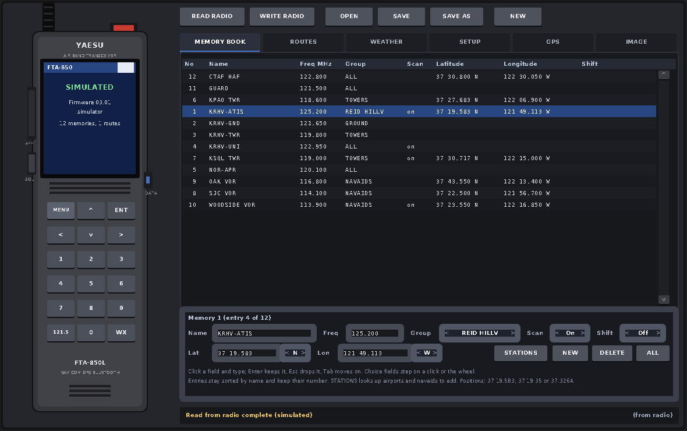
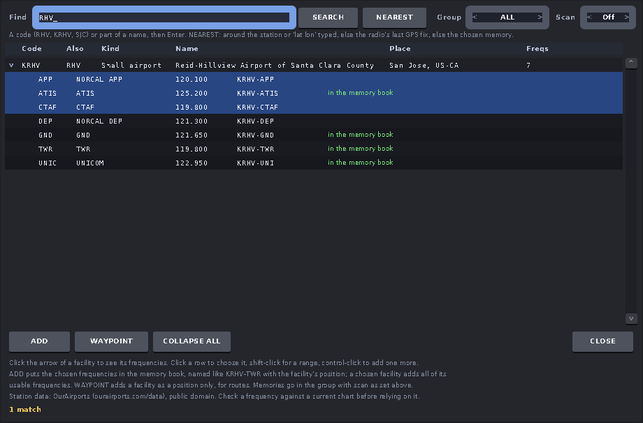
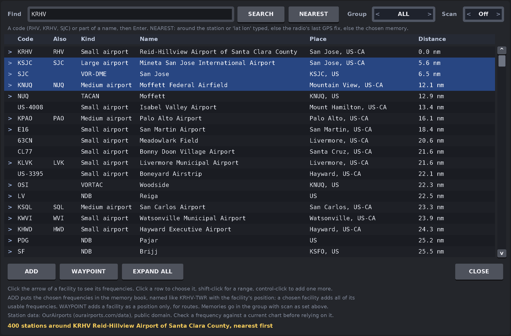
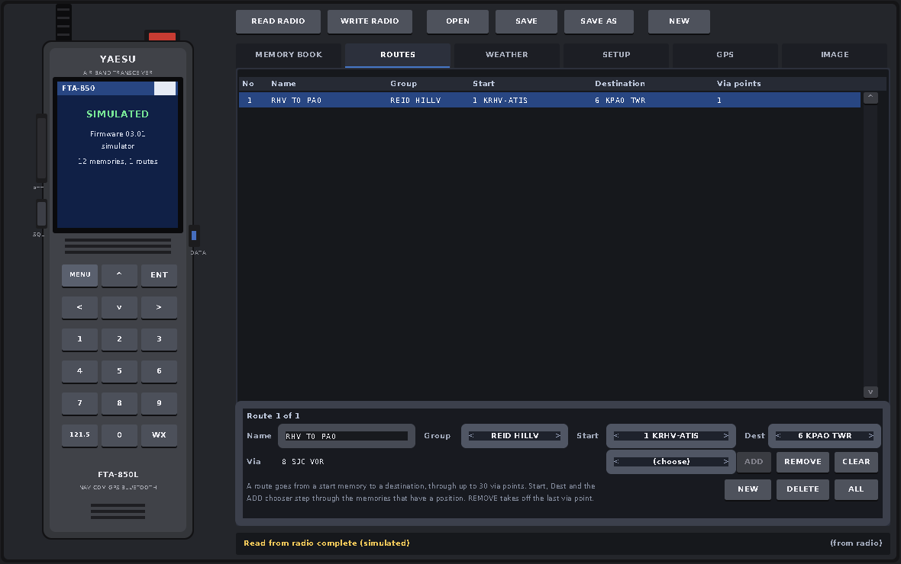
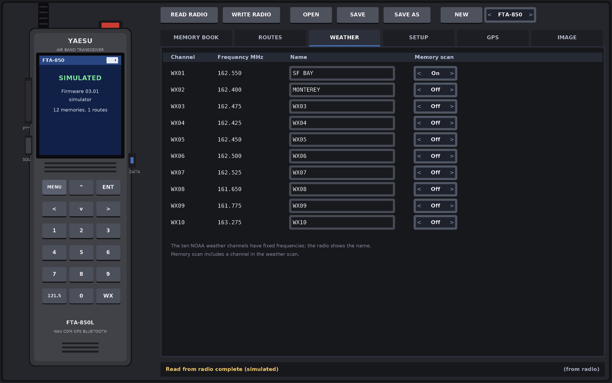
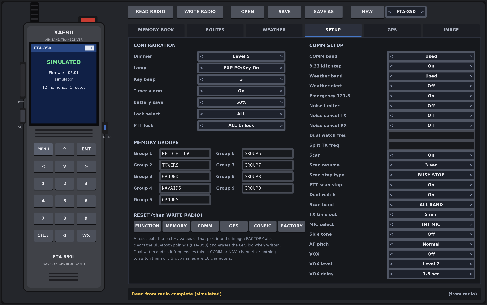
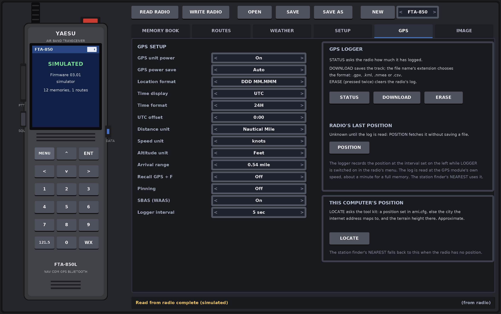
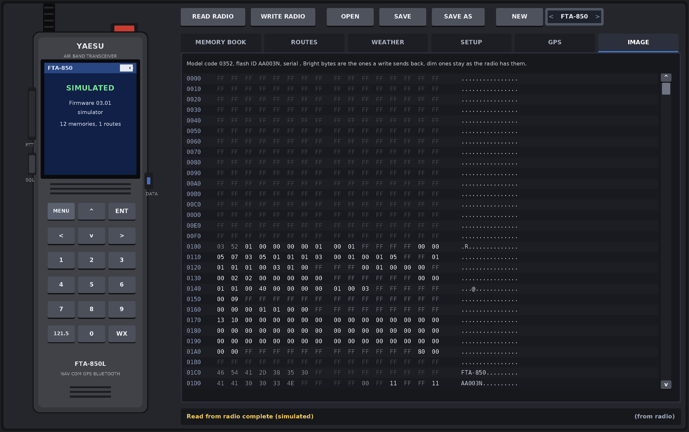
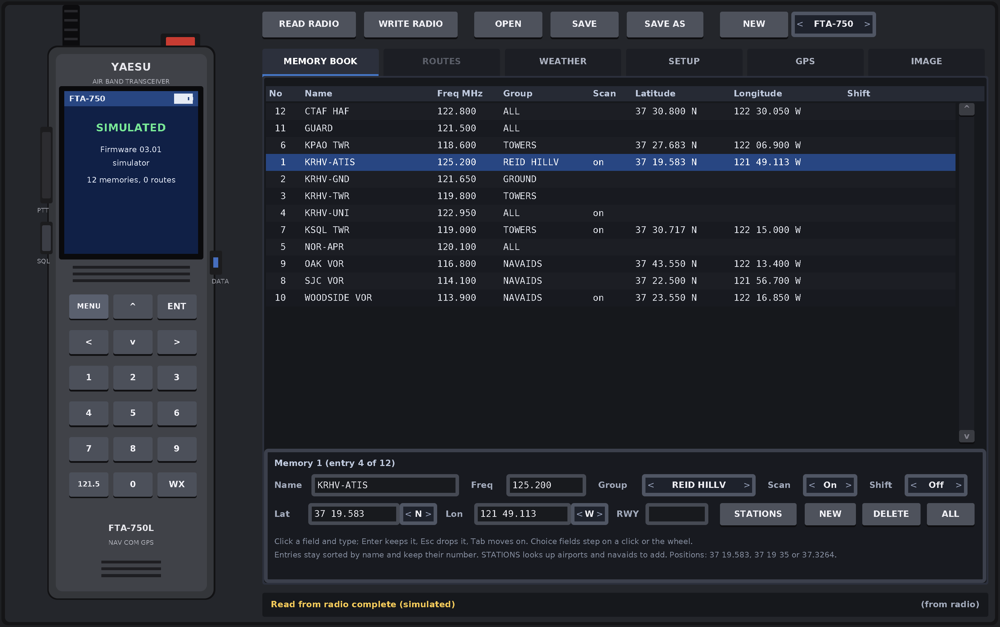

# FTA-850 programmer: user manual

A programmer for the Yaesu FTA-850L, FTA-750L, FTA-550L and FTA-450L air
band handhelds. It reads the radio's memory over USB, lets you edit the
memory book, routes, weather channels and setup menus on screen, looks up
airports and navaids to add, downloads the GPS log, and writes the result
back. A command line tool does the same without a window.

1. [Getting started](#getting-started)
2. [Putting the radio in CP mode](#putting-the-radio-in-cp-mode)
3. [The window](#the-window)
4. [Working with the image](#working-with-the-image)
5. [The memory book](#the-memory-book)
6. [The station finder](#the-station-finder)
7. [Routes](#routes)
8. [Weather channels](#weather-channels)
9. [Setup](#setup)
10. [GPS and the logger](#gps-and-the-logger)
11. [The image page](#the-image-page)
12. [Writing to the radio](#writing-to-the-radio)
13. [The models](#the-models)
14. [The command line tool](#the-command-line-tool)
15. [Keyboard reference](#keyboard-reference)
16. [Files and folders](#files-and-folders)
17. [When something goes wrong](#when-something-goes-wrong)

## Getting started

Build it with `make` in the project folder; it needs the AMI tool kit in
`~/projects/amitk` (or `AMIDIR=...`). `make install` puts "FTA-850" and
"FTA-850 (simulated)" in the application menu.

    cd ~/projects/yaesu_FTA-850
    make
    ./fta850              # find the radio on USB
    ./fta850 -p /dev/ttyACM1
    ./fta850 --sim        # no radio: a simulated FTA-850 with sample memories
    ./fta850 --sim 750    # a simulated FTA-750 (or 550, 450)

On Linux your account has to be in the `dialout` group to open the port;
the status bar says so if it is not.

The window opens sized from the console font (`console_points` in
`ami.cfg`, 11 points at the display's DPI unless set), and everything in
it scales when you resize the window. Make it bigger or smaller as you
like; raise `console_points` to make it bigger from the start.

The simulator is a good way to learn the program: every page works on a
made up radio, nothing you do reaches hardware, and the station finder
works the same.

## Putting the radio in CP mode

The radio only talks to the computer in its programming mode, which Yaesu
calls CP mode:

1. Plug the USB cable into the DATA jack under the rubber cover on the
   right side.
2. Switch the radio off.
3. Hold a key and switch it on: **SQL** on an FTA-850, **MENU** on an
   FTA-750, 550 or 450. The radio beeps and its screen says CP MODE.

The panel's drawn radio shows what it sees. When the radio is on but in
its normal mode the drawn screen says NOT IN CP MODE and the SQL key
blinks; clicking that key shows the instructions for your model. When the
session is up the screen says the model and firmware, for example
"FTA-850, Firmware 02.02.00".

The program tells the models apart by reading a model code out of the
radio at the start of the session, so there is nothing to choose. (All
four report themselves the same way on USB, and an FTA-850 even calls
itself an FTA-750 there, so the USB name cannot be trusted.)

When you are done, switch the radio off and on again to use it normally.

## The window

- **Left**: a drawing of the radio. Its screen is the link status: looking
  for the radio, not in CP mode, connected, or the progress of a transfer.
- **Top**: READ RADIO, WRITE RADIO, OPEN, SAVE, SAVE AS, NEW, and beside
  NEW the model a new image is for. CANCEL appears during a transfer.
- **Tabs**: MEMORY BOOK, ROUTES, WEATHER, SETUP, GPS, IMAGE. A tab a model
  does not have (ROUTES on the 750 family) is greyed.
- **Bottom**: the status bar. Left, the link status or the last message;
  right, the file the image came from, with `*` when it has unsaved
  changes, or "(from radio)".

Everything you edit lives in an *image*: a copy of the radio's whole
configuration memory. READ RADIO fills it from the radio, OPEN from a
file, NEW with factory defaults. The pages edit the copy. Nothing reaches
the radio until WRITE RADIO.

Text fields: click one and type. Enter keeps the change, Esc drops it,
Tab moves to the next field. Choice fields (the ones with `<` and `>`)
step to the next value when clicked in their right half, the previous in
their left half; the mouse wheel steps them too. Lists scroll with the
wheel, the scroll bar, PageUp and PageDown, Home and End; Up and Down move
the chosen row.

Buttons that do something hard to undo (WRITE RADIO, ERASE, ALL, FACTORY,
and OPEN, NEW or READ RADIO when there are unsaved changes) ask to be
pressed twice: the first press turns them red and says CONFIRM for four
seconds.

## Working with the image

| Button | What it does |
|---|---|
| READ RADIO | Fetches the radio's memory into the panel. 32 kB on an FTA-850 (about 30 s), 16 kB on the others. Replaces what was loaded. |
| WRITE RADIO | Programs the panel's image back. See [Writing to the radio](#writing-to-the-radio). |
| OPEN | Loads a `.dat` file: one saved here, or one from Yaesu's YCE46 or YCE01 software, which use the same format. The model comes from the file. |
| SAVE / SAVE AS | Writes the image to a `.dat` file. SAVE reuses the name it was opened from or asks for one. |
| NEW | A factory default image for the model shown beside the button: no memories, everything as delivered. The choice follows the connected radio once it is known; click it to make an image for another model. |
| CANCEL | Stops the transfer in progress. The image is then incomplete and should be read again. |

Always SAVE a copy of the first read from a radio before changing
anything, so you can put it back.

## The memory book

The radio's memories: 400 on the FTA-850, 200 on the others, each with:

- **Name**: 14 characters on the FTA-850, 15 on the others. Letters,
  digits, space and `* + , / & - [ ] .`.
- **Freq**: a COMM channel, 118.000 to 136.975 MHz, or on models with a
  NAV band a NAVI channel, 108.000 to 117.975 MHz, in 25 kHz steps. With
  the 8.33 kHz step switched on in SETUP, the 8.33 kHz channel numbers the
  radio shows (xxx.005, .010, .015, .030, .035, .040 ...) are accepted too.
  Type it as `121.5`, `121.500` or `121500`. An entry may have no frequency
  if it has a position: that makes it a waypoint.
- **Group**: ALL or one of the nine groups named on the SETUP page. On the
  750 family group 1 is always FLAG.
- **Scan**: whether the memory is in the memory scan.
- **Shift**: the spurious shift the radio offers for a channel with
  interference.
- **Lat / Lon**: the position, for the radio's navigation functions and
  for routes. Enter degrees and minutes (`37 19.583`), degrees minutes
  seconds (`37 19 35`) or decimal degrees (`37.3264`); the hemisphere is
  the choice beside the field. Clear the field to remove the position.
  The FTA-450 keeps no positions.
- **RWY** (750 family only): the runway true course, `310` or `310.50`.

NEW adds an entry and puts you in its name; DELETE removes the chosen
one; ALL, pressed twice, empties the whole book and the routes. STATIONS
opens the station finder, below.

Entries stay sorted by name, as Yaesu's software keeps them, and each
keeps its **memory number**, the number in the first column, which is
what the radio shows and what routes refer to. A new entry gets the lowest
free number. A memory a route uses cannot be deleted; change the route
first.

An entry that is not complete (no name, no frequency and no position, a
bad frequency) is explained in orange under the editor, and WRITE RADIO
refuses an image that has one.

## The station finder

STATIONS on the memory page, or the `f` key, opens a second window that
looks up airports, heliports, seaplane bases and navaids with their
frequencies and positions, from the OurAirports database (public domain,
https://ourairports.com/data/, kept in the `data` folder; `make data`
fetches fresh copies).

**Searching.** Type a code or a name in the Find field and press Enter
(or SEARCH):

- A three or four letter code: `RHV`, `KRHV`, `SJC`. Exact matches come
  first and are opened to show their frequencies.
- Part of a name or a town, three letters or more: `reid`, `san jose`.
  Each facility shows closed; the `>` arrow in front of it (or Right with
  it chosen) opens it, EXPAND ALL opens everything.

The list is a tree: a facility row with its code, kind, name, place and
how many frequencies it has, and under it one row per frequency with its
type (TWR, GND, ATIS, CTAF, UNICOM, APP, DEP, AWOS ...), description,
frequency, the memory name it would get, and a note when it is already in
the memory book, outside the radio's bands, or needs the 8.33 kHz step.

**Nearest.** NEAREST lists the 400 closest stations with their distance in
nautical miles, around the first of these it has:

1. a station code or a `lat lon` pair typed in the Find field;
2. the radio's last GPS fix, if a log has been read in this session (it
   reads the log from the radio for you when the radio is connected);
3. the position of the memory chosen on the memory page;
4. this computer's position, as the GPS page's LOCATE finds it (see
   below), marked approximate.

The status line at the bottom of the window says which one it used.

**Choosing and adding.** Click a row to choose it (it turns blue).
Shift-click another row to choose everything between, control-click to
add or remove one row. Up and Down move the choice. Then:

- **ADD** puts the chosen frequencies in the memory book, named after the
  facility and the type, `KRHV-TWR` style (`UNICOM` becomes `UNI`,
  `VOR-DME` and `VORTAC` become `VOR`), each with the facility's position.
  A chosen facility row adds all of its usable frequencies at once. What
  is already in the book, outside the bands, or an 8.33 kHz channel while
  that step is off is skipped, and the status line says what happened.
- **WAYPOINT** adds the chosen facility as a position only, no frequency,
  which routes can use.
- **Group** and **Scan** at the top set what the new memories get.

The main window needs an image loaded (READ RADIO, OPEN or NEW) before
ADD lights; the status line says so otherwise. Esc or CLOSE shuts the
finder.

The data is volunteer maintained. Check a frequency against a current
chart or supplement before relying on it in the air.

## Routes

FTA-850 only. Up to 40 routes, each a name, a group, a start memory, a
destination memory and up to 30 via points, all memories that have a
position.

NEW adds a route; the Start and Dest choices step through the memories
with positions; the ADD chooser beside them picks a via point and ADD
appends it, REMOVE takes the last one off, CLEAR removes them all. DELETE
removes the route, ALL (twice) every route. A route that is not complete
is explained under the editor and blocks WRITE RADIO.

## Weather channels

The ten NOAA weather channels have fixed frequencies; what you can change
is each one's name and whether it is in the weather scan.

## Setup

The Configuration and COMM Setup menus of the radio, the group names, and
the resets.

The settings are the ones the radio's own menus offer, with the same
names and values. Dual watch and split frequencies take a channel or
nothing (clear the field) to switch them off. A setting a model lacks is
not shown.

**Memory groups**: the nine group names, 10 characters each. On the 750
family group 1 is FLAG and cannot be renamed.

**Resets** put the factory values of one part of the image back:
Function, Memory, COMM, GPS, Configuration, Factory on the FTA-850; the
750 family joins COMM and GPS. FACTORY must be pressed twice. A reset only
changes the image; WRITE RADIO sends it, and a factory reset also writes
the parts of the memory a normal write leaves alone (Bluetooth pairings
on the FTA-850) and erases the GPS log.

## GPS and the logger

On the left, the GPS Setup menu (models with GPS). On the right:

**GPS LOGGER.** The radio records its position while LOGGER is switched on
in its own GPS menu, at the interval set on the left. STATUS asks how many
records it holds. DOWNLOAD saves the track to a file; the extension picks
the format: `.gpx`, `.kml`, `.nmea` (as Yaesu's software writes) or
`.csv`. ERASE, pressed twice, clears the log. The log is read at the GPS
module's own pace, about a minute for a full memory.

**RADIO'S LAST POSITION.** The newest point of the log, with the time it
was logged. POSITION reads the log from the radio without saving a file.
The radio has no "where am I" command in CP mode, so this is the only
source; a radio whose logger has never been on has none to give.

**THIS COMPUTER'S POSITION.** LOCATE asks the tool kit where the computer
is: a position set in the services block of `ami.cfg` (`latitude`,
`longitude`, `altitude`), or failing that the city its internet address
maps to and the terrain height there, from public services, approximate
and only on request. The figures are shown with where each came from;
altitude is in feet. `location_lookup 0` in `ami.cfg` forbids the network.
The station finder's NEAREST uses this when nothing better is known.

## The image page

A hex dump of the whole image: address, bytes, and the printable
characters, so names and the serial number can be read directly. Bright
bytes are the ones WRITE RADIO sends; dim ones are left alone on a write
(the radio's identity, calibration, Bluetooth pairings, unused parts). It
is read only: use it to see what a read brought in, what a write will
touch, or to compare two images.

## Writing to the radio

WRITE RADIO, pressed twice, programs the image into the radio:

1. The image is checked: every memory and route complete, and the model
   the same as the radio's. An FTA-750 image is refused by an FTA-850 and
   the other way round, before anything is sent.
2. The radio's own model code is read and compared again.
3. The areas Yaesu's software writes are sent, 64 bytes at a time, with a
   status poll before each. The identity, calibration and (on the FTA-850)
   the Bluetooth pairings are never written, unless a factory reset is
   pending.
4. Switch the radio off and on again to use it.

If something goes wrong the status bar says what, and CANCEL stops a
transfer. A radio left with a half written memory should be written again
from a saved image.

On an FTA-850 the firmware has to be 2.01 or later to be programmed; the
panel checks.

## The models

| Model | Image | Memories | Names | Routes | GPS | NAV band | Positions | CP mode key |
|---|---|---|---|---|---|---|---|---|
| FTA-850L | 32 kB | 400 | 14 | 40 | yes | yes | yes | SQL |
| FTA-750L | 16 kB | 200 | 15 | no | yes | yes | yes, with a runway course | MENU |
| FTA-550L | 16 kB | 200 | 15 | no | no | yes | yes | MENU |
| FTA-450L | 16 kB | 200 | 15 | no | no | no | no | MENU |

The FTA-850L has been exercised on a real radio (reading, status and the
logger; the first write is still to be tried). The other three were built
from Yaesu's YCE01 software and its default images and checked against the
simulator only. On a real one: READ RADIO, SAVE the file, write it back
unchanged, and only then edit.

Files from Yaesu's own programs open directly: YCE46's for the FTA-850,
YCE01's for the others. Files saved here open in those programs too.

## The command line tool

`fta850cli` works the link and the files without a window, for scripts and
for checking a radio:

    fta850cli info                      find the radio, show its model, mode and firmware
    fta850cli read radio.dat            read the radio into a file and list it
    fta850cli write radio.dat           program the radio from a file
    fta850cli show radio.dat            list a file: memories, routes, weather, settings
    fta850cli new radio.dat [750]       a factory default file (850 unless a model is given)
    fta850cli logstat                   how much the GPS logger holds
    fta850cli log track.gpx             download the GPS log (.gpx .kml .nmea .csv)
    fta850cli erase                     erase the GPS log
    fta850cli search RHV                look up airports and navaids by code or name
    fta850cli nearest KRHV              the stations around a station, "37.33 -121.82",
                                        or "here", this computer's position
    fta850cli add radio.dat KRHV        add a station's usable frequencies to a file;
                                        "add radio.dat KSJC TWR,GND,ATIS -g 2 -scan"
                                        picks types, group and scan

`-p PORT` names the serial port, `--sim [850|750|550|450]` uses the
simulator. Everything it prints about a radio comes from the same code the
panel uses.

## Keyboard reference

Main window:

| Key | Action |
|---|---|
| 1 to 6 | choose a page |
| r | READ RADIO |
| w | WRITE RADIO (twice) |
| o | OPEN |
| s | SAVE |
| n | NEW memory (memory page) or route (routes page) |
| f | the station finder |
| Delete | delete the chosen memory or route |
| Up, Down | move in the list |
| PageUp, PageDown, Home, End | scroll |
| Left, Right | change the chosen memory's group |
| Enter | edit the chosen memory's or route's name |
| Tab | next field while editing |
| Esc | drop the edit |

Station finder:

| Key | Action |
|---|---|
| typing, Enter | the query, search |
| Up, Down | move the choice (with shift: extend it) |
| Left, Right | close or open the chosen facility |
| PageUp, PageDown, Home, End | scroll |
| Esc | drop a changed query, or close the window |

## Files and folders

- `fta850`, `fta850cli`: the programs. `make install` adds menu entries
  that run `fta850` from this folder.
- `ami.cfg`: the tool kit's settings, with the window size
  (`console_points`) and the location keys described above.
- `data/`: the OurAirports station files and a note on their origin.
- `doc/`: this manual and the pictures.
- `.dat` files: images, 32 or 16 kB, the format Yaesu's software uses.

## When something goes wrong

**"No radio found on USB."** The radio is off, not plugged into the DATA
jack, or on a port the program does not look at (`-p PORT` names one). On
Linux it appears as `/dev/ttyACM*` and `/dev/serial/by-id/usb-YAESU_...`.

**"No permission for /dev/ttyACM1."** Join the `dialout` group
(`sudo usermod -aG dialout $USER`, then log in again).

**"Radio is on but not in CP mode."** See [Putting the radio in CP
mode](#putting-the-radio-in-cp-mode). The status bar names the key.

**"Port open, radio not answering."** Another program may hold the port
(a second copy of this panel, a terminal program, another panel that
scans serial ports). Close it, or unplug and replug the radio.

**"Read from radio failed: no answer."** The same: something else is
talking on the port, or the radio was switched off mid transfer.

**"The logger holds no data."** The radio's logger has never been
switched on, or was erased. Switch LOGGER on in the radio's GPS menu, let
it get a fix, and try again.

**ADD is greyed in the station finder.** Load an image first (READ RADIO,
OPEN or NEW), then choose a row.

**"The radio is an FTA-850 and the image is for an FTA-750."** The file
is from another model; NEW makes one for the right model.

**The window is tiny.** Raise `console_points` in `ami.cfg`, or just
resize the window; everything scales.
